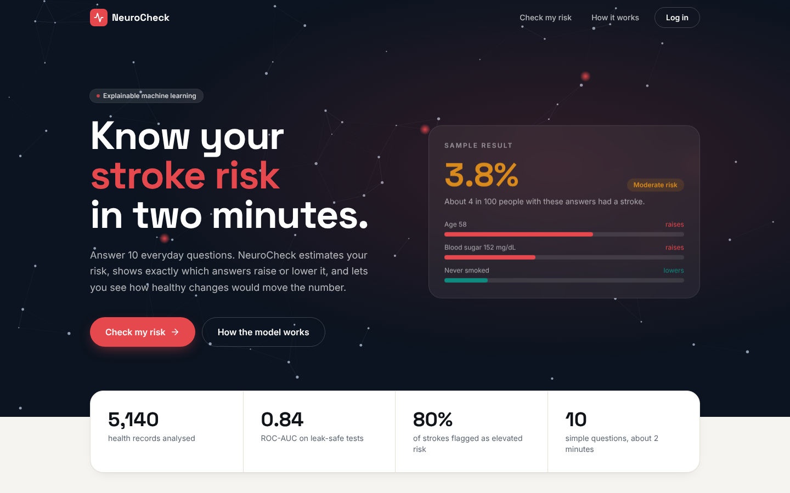
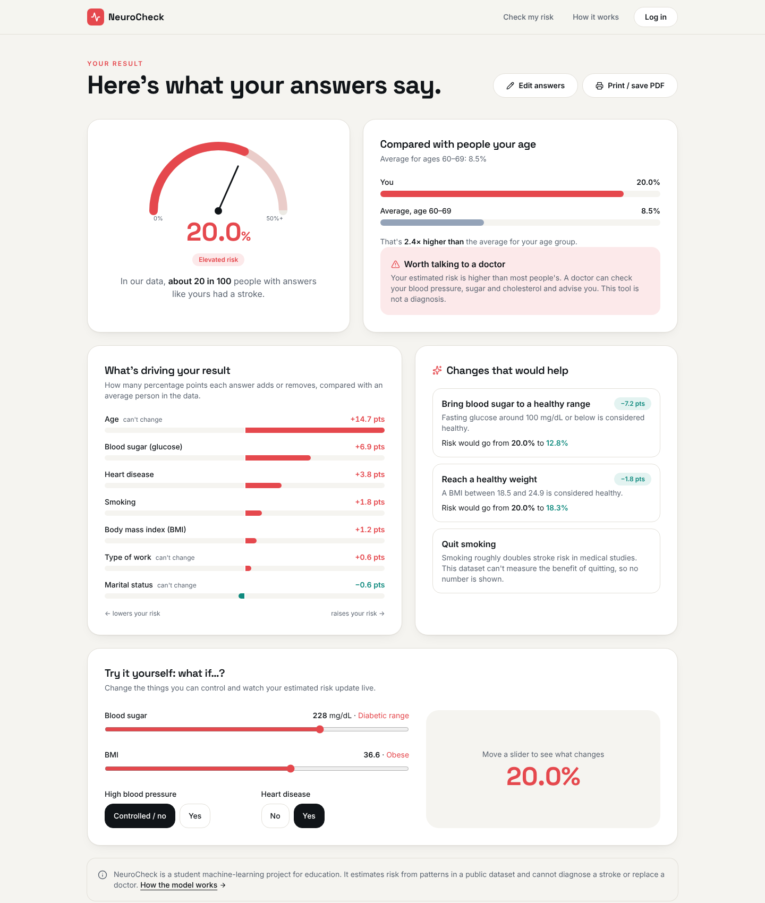
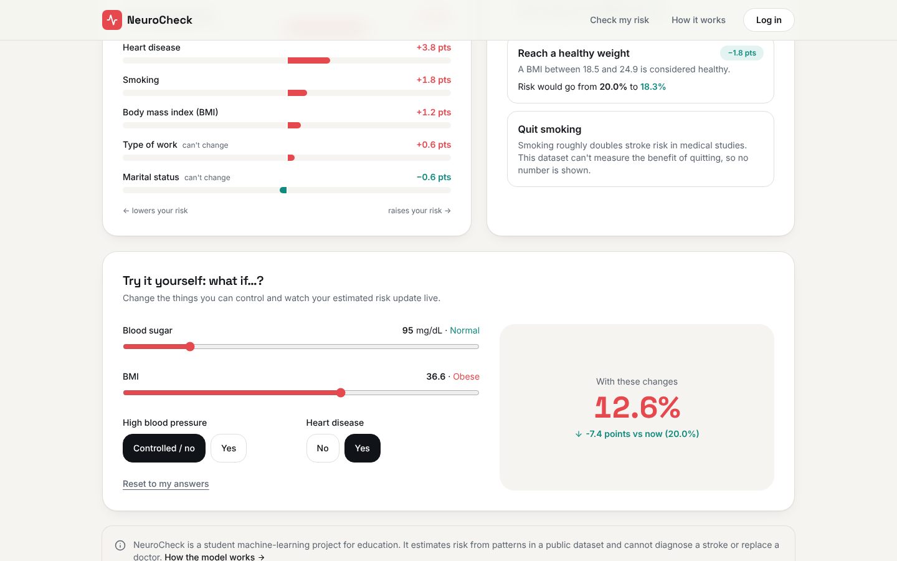
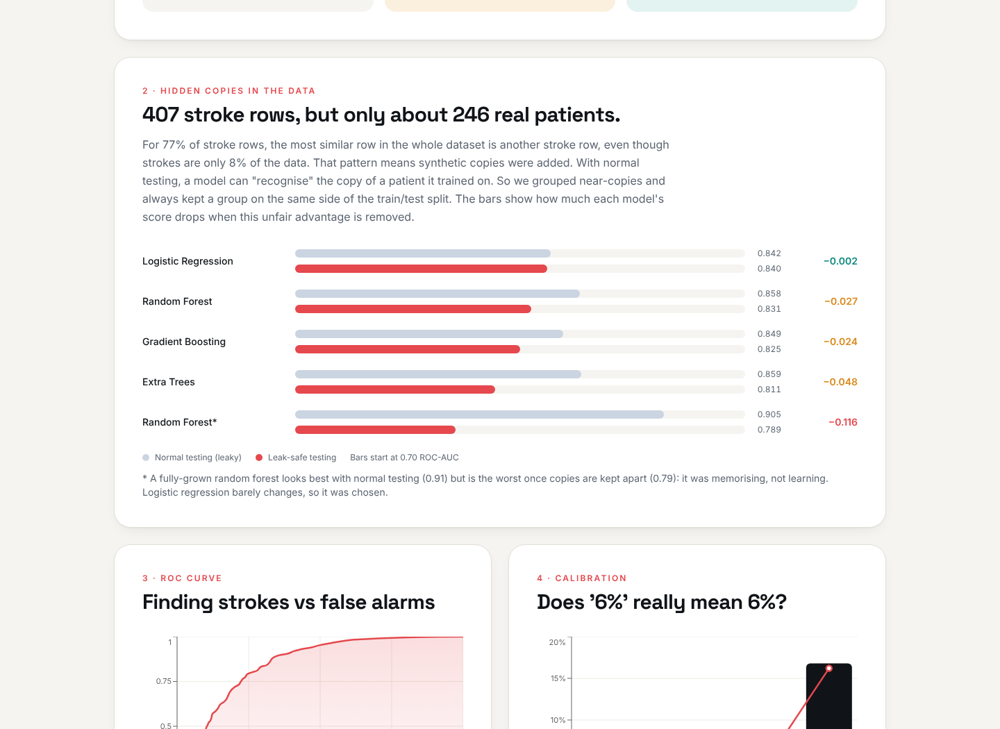

<div align="center">

# NeuroCheck

**Explainable stroke-risk assessment: a full-stack machine-learning web app.**

React · Flask · scikit-learn · SQLAlchemy · JWT

</div>



NeuroCheck asks 10 everyday health questions and estimates a person's stroke risk as a **real, calibrated probability**. It then shows exactly which answers raise or lower that risk, and lets the user test changes ("what if my blood sugar were normal?") with live recalculation.

The most important part of this project isn't the UI. While rebuilding the model, I found that the public dataset contains **hidden synthetic copies of stroke patients**, which make normal testing look far better than reality. NeuroCheck's model is tested with those copies kept apart, so every number it shows is honest.

> NeuroCheck is an educational project, not a medical device. It cannot diagnose a stroke.

## Highlights

**Machine learning**
- **Leakage found and fixed:** 77% of stroke rows have another stroke row as their nearest neighbour (vs ~8% expected). Grouping near-duplicates collapses 407 stroke rows into **246 real patients**, matching the 249 cases in the original public dataset.
- **Leak-safe evaluation:** `StratifiedGroupKFold` keeps each group of copies in one fold. This drops a fully-grown random forest from 0.91 to 0.79 ROC-AUC, exposing memorisation.
- **Model selection on honest scores:** logistic regression, random forest, gradient boosting, extra trees, XGBoost and LightGBM were compared. The best leak-safe model is **calibrated logistic regression, ROC-AUC 0.84**.
- **Calibrated probabilities:** copies are weighted as one patient and no class re-balancing is applied, so "6% risk" really means about 6 in 100 (checked on held-out data).
- **Screening threshold:** the "elevated risk" line catches **80% of stroke patients**, because for screening a missed case is worse than a false alarm.
- **Exact explanations:** each answer's contribution in percentage points, computed from the model's additive structure. No black box.

**Web app**
- 3-step assessment wizard with validation, a BMI calculator and reference ranges for glucose and BMI
- Result page with an animated risk gauge, a comparison with the user's age group, a factor chart and suggested changes
- **Live "what-if" simulator:** sliders call the API and update the risk in real time
- "How it works" page with ROC curve, calibration chart, leak-safe comparison and confusion matrix in plain language
- Optional accounts: hashed passwords, JWT auth, saved history with a trend chart
- Rate limiting, input validation, responsive design, print-to-PDF report, F.A.S.T. stroke warning signs

| Result | What-if simulator |
|---|---|
|  |  |



## Results

All numbers come from 5-fold leak-safe cross-validation, repeated 3 times.

| Model | ROC-AUC (normal CV) | ROC-AUC (leak-safe) |
|---|---|---|
| **Logistic Regression (final)** | 0.842 | **0.840** |
| Random Forest (min leaf 30) | 0.857 | 0.833 |
| Gradient Boosting | 0.848 | 0.827 |
| Extra Trees | 0.859 | 0.813 |
| Random Forest (fully grown) | 0.906 | 0.794 |

Final model: ROC-AUC **0.84**, recall **80%** at the elevated-risk threshold, specificity **74%**, Brier score **0.043**.

**Why not accuracy?** Only 8% of people in the data had a stroke, so a model that always answers "no" is 92% accurate and useless. The first version of this project reported 84% accuracy on an 81-row test set. Repeating that test with 20 different random splits gives anywhere from 74% to 89%. The analysis notebook shows this step by step.

## How it works

```
React (Vite)  ──►  Flask REST API  ──►  model.json (trained with scikit-learn, served with NumPy)
                         │
                         └──►  SQLite via SQLAlchemy (users, saved results)
```

| Endpoint | Description |
|---|---|
| `POST /api/predict` | Risk, level, age-group comparison, factor breakdown, what-if suggestions |
| `GET /api/model` | Evaluation metrics shown on the "How it works" page |
| `POST /api/auth/register`, `POST /api/auth/login`, `GET /api/auth/me` | Accounts (JWT) |
| `GET /api/history`, `DELETE /api/history/<id>` | Saved assessments |

## Run it locally

You need **Python 3.10 or newer** (any version, including 3.14) and **Node.js 18+**.

```bash
git clone https://github.com/Megharaykar27/NeuroCheck.git
cd NeuroCheck

# 1. API
cd server
python -m venv venv
venv\Scripts\activate            # macOS/Linux: source venv/bin/activate
pip install -r requirements.txt
copy .env.example .env           # macOS/Linux: cp .env.example .env
python app.py                    # http://localhost:5001

# 2. Web app (new terminal)
cd client
npm install
npm run dev                      # http://localhost:5173
```

The trained model is already included as `server/model/model.json`. The API rebuilds the model's maths with NumPy from that file, so it doesn't need scikit-learn and installs quickly on any Python version. To retrain it and regenerate every metric:

```bash
cd ml
pip install -r requirements.txt
python train.py
```

## Project structure

```
NeuroCheck/
├── ml/
│   ├── data/brain_stroke.csv   dataset (5,140 rows)
│   ├── train.py                leak-safe training + evaluation, exports server/model/
│   └── analysis.ipynb          EDA, duplicate detection, model comparison
├── server/
│   ├── app.py                  Flask API, auth, history
│   ├── predictor.py            validation, prediction, explanations, what-if
│   └── model/                  model.json (weights) + metrics.json
├── client/src/
│   ├── pages/                  Home, Assess, Result, Model, History, Login
│   └── components/             RiskGauge, NeuralCanvas, Navbar…
└── docs/                       screenshots
```

## What I learned

- Check a dataset for duplicates and synthetic rows **before** trusting any cross-validation score.
- On imbalanced medical data, use ROC-AUC, recall and calibration instead of accuracy.
- Once the leak was fixed, the simplest model won, and it is also the easiest to explain to users.

## Data

Brain stroke dataset (5,140 records, 10 features), derived from the public Kaggle stroke-prediction data. The stroke cases include near-duplicate synthetic rows, which this project detects and accounts for.

---

Built by **Megha Raykar** · [GitHub](https://github.com/Megharaykar27) · [LinkedIn](https://www.linkedin.com/in/megha-raykar-335617337/)
